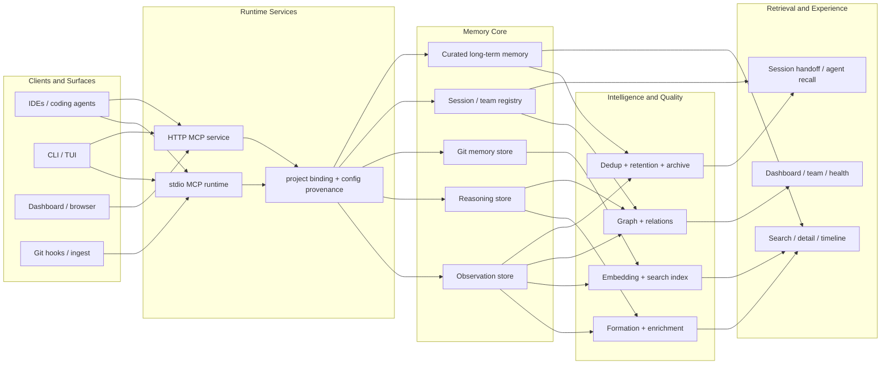
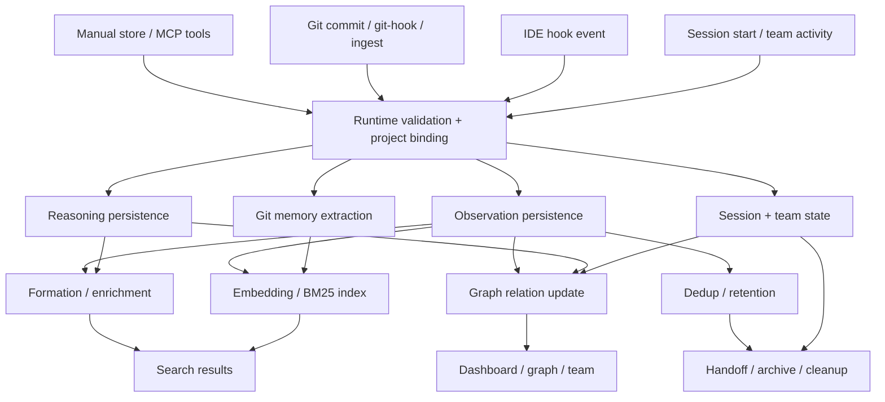
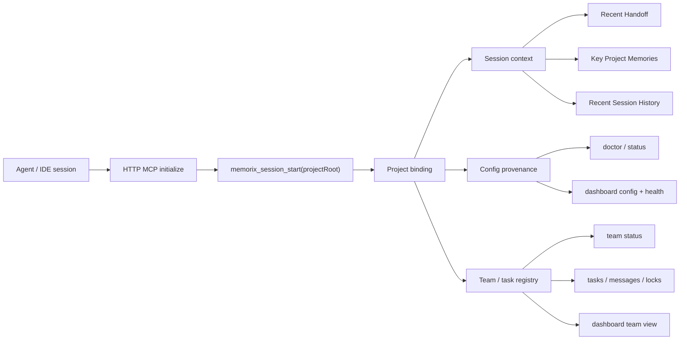

# Memorix Architecture

Memorix is an open-source cross-agent memory layer for coding agents via MCP.

> **Architecture audit: 2026-11-05**
>
> The current implementation is feature-rich but boundary-fragile. The largest
> runtime files are `src/server.ts` (~5.5k lines), `src/store/orama-store.ts`
> (~1.7k), `src/memory/observations.ts` (~1.6k), and
> `src/cli/commands/setup.ts` (~1.9k). Around 139 direct environment/config
> reads are spread across `src/`, and multiple hosts assemble the same project
> context independently. This explains why fixes repeatedly appear in several
> layers and why derived-index failures can look like successful empty state.
>
> The project is not suffering from one bad model or one bad dependency. It has
> a missing kernel boundary: canonical records, derived views, retrieval policy,
> runtime hosts, and maintenance jobs are implemented as cooperating conventions
> rather than enforceable interfaces. New features therefore cross too many
> mutable singletons and can regress lazy mode, search ranking, retention, or
> cross-process behavior without a compiler error.
>
> The target architecture below is the refactor contract for 1.11. It preserves
> SQLite local-first semantics and avoids a wholesale storage rewrite.

## 0. Current Architecture Audit and Refactor Target

### 0.1 What is going wrong

1. **Canonical and derived state are mixed in control flow.** SQLite is the
   documented source of truth, but Orama, Lance, CodeGraph, cache hydration,
   and in-memory observation state each have their own readiness and repair
   paths. A lazy corpus can be empty in memory while still being healthy in
   SQLite, yet older callers interpret the empty array as "no missing work".
2. **The write pipeline has too many owners.** Observation persistence,
   embedding scheduling, CodeGraph binding, evidence projection, claims, and
   maintenance enqueueing all happen from `memory/observations.ts`. A provider
   or index failure can therefore affect unrelated write behavior and is hard to
   test as an isolated contract.
3. **Retrieval policy is distributed.** `server.ts`, `orama-store.ts`, CodeGraph
   context assembly, compact formatting, and profile registration each shape
   what the agent sees. There is no single retrieval plan object that records
   candidate sources, freshness, cost, abstention, and final selection.
4. **Background jobs report lifecycle, not truth.** A job can reach `completed`
   while doing zero useful work in a lazy or unavailable state. Maintenance
   needs progress counters and explicit `degraded`/`retry` outcomes.
5. **Runtime hosts duplicate binding and policy.** stdio, HTTP, hooks, CLI, and
   Dashboard call adjacent functions with different defaults. The codegraph
   refresh policy and project binding must be resolved once and passed down.
6. **The current graph is a derived cache without a full retention owner.**
   Snapshot manifests and stale symbols were allowed to grow until #371. The
   same failure pattern already appeared in Lance metadata in #365.

### 0.2 Target layers

```text
Host adapters
  stdio MCP | HTTP MCP | CLI | hooks | dashboard | SDK
        |
Runtime facade
  ProjectBinding + ResolvedConfig + SessionScope + RetrievalRequest
        |
Memory kernel
  WritePipeline | RetrievalFacade | MaintenanceCoordinator | EvidencePolicy
        |
Canonical record plane
  SQLite records, scopes, provenance, lifecycle, optional append-only events
        |
Derived view plane
  FTS | Orama | Lance | CodeGraph | receipts | caches
```

Host adapters may depend on the runtime facade. The runtime facade may depend on
the memory kernel. Derived views may read canonical records and publish health,
generation, and rebuild operations, but they may never decide that canonical
storage is empty or successful. The kernel owns policy; views own mechanics.

### 0.3 Non-negotiable contracts

- **Canonical truth:** all durable records have a stable ID, project/scope,
  provenance, lifecycle state, created/updated time, and source revision. An
  index row is never the only copy of a fact.
- **Derived view contract:** every view implements `status`, `refresh`,
  `rebuild`, `compact`, and `close`; status distinguishes `ready`, `stale`,
  `degraded`, `rebuilding`, and `unavailable`. No derived failure returns a
  fake empty result without a receipt.
- **Write contract:** the canonical write commits first. Derived work is an
  idempotent outbox/maintenance action with `attempted`, `succeeded`, `failed`,
  and `remaining` counts. A completed job with zero attempted work is not a
  successful backfill.
- **Retrieval contract:** one `RetrievalPlan` carries query intent, project
  binding, allowed sources, freshness policy, token budget, and abstention
  rules. One `RetrievalReceipt` records candidates, selected IDs, omitted IDs,
  source generations, elapsed time, and degraded reasons.
- **Freshness contract:** current truth and historical belief are separate.
  Changing a fact supersedes or invalidates the old version; it does not erase
  the audit record. Future temporal memory work should use valid-time and
  transaction-time fields rather than another overwrite-only vector row.
- **Context contract:** retrieval is progressive disclosure. Index/abstract
  first, overview next, full detail only on demand. A search tool must never
  return a large raw corpus as its default answer.
- **Config contract:** providers, refresh policy, thresholds, and credentials
  are resolved once into an immutable runtime config. Business modules do not
  read `process.env` directly.
- **Maintenance contract:** retention, compaction, backfill, and graph refresh
  are resumable, observable, bounded, and safe when another process is active.

### 0.4 Refactor sequence

**P0 - contract extraction, current patch line:** complete the missing safety
fixes, preserve local SQLite, and add regression tests for lazy vectors, CJK
search, affinity ordering, CodeGraph growth, shell-free browser launch, and
provider isolation.

**P1 - 1.11 kernel extraction:** introduce `src/core/` contracts for
`ProjectBinding`, `ResolvedRuntimeConfig`, `RetrievalPlan`, `RetrievalReceipt`,
`DerivedView`, and `MaintenanceResult`. Move host code behind these interfaces;
do not move data tables yet. Add architecture tests for allowed dependency
directions and one store-to-search-to-detail integration fixture.

The first P1 slice is implemented: `RuntimeContext` captures a verified project
and immutable per-request config; CodeGraph uses it. Lance has a concrete
`DerivedView` adapter used by vector writes. Other hosts and derived views still
need migration. A dependency test now rejects host, persistence, and adapter
imports from `src/core/`. `MaintenanceResult` is defined in the kernel; its
progress counts are validated before a runner persists them. Maintenance
progress is durable in SQLite. The MCP server captures a `RuntimeContext` after
project binding and refreshes it on runtime activation and project switch;
CodeGraph host operations consume that immutable configuration snapshot.

**P2 - 1.11 durable write pipeline:** add a small canonical write service and
an idempotent derived-work outbox. Observation capture, Git ingest, and
explicit MCP store calls use the same pipeline. Keep formation and provider
calls outside canonical SQLite transactions.

The first P2 slice is implemented for vector work: observation writes register
the deduplicated backfill job inside the SQLite transaction, foreground success
leaves project-level work for the worker to verify, and maintenance rows persist
real progress counters. The same transaction now also registers qualification
and claim derivation for inserted observations and topic-key updates. Topic-key
updates commit SQLite before refreshing Orama; a failed canonical write or
linked-record callback leaves the prior search result in place. Other derived
projections remain to migrate.

The outbox also records writes that arrive during a running deduplicated job.
The worker either performs a follow-up pass after completion, or preserves the
new work through retry exhaustion and lease recovery. Recurring jobs process a
new event before returning to their long schedule; provider retry cooldowns
remain in force. The new SQLite flag defaults to false for pre-1.11 rows.

Automatic cleanup jobs re-check the resolved behavior configuration when they
execute. Disabling `memory.autoCleanup` therefore neutralizes already queued
retention, consolidation, and long-term maintenance work without affecting
explicit user-requested cleanup actions.

**P3 - 1.11 retrieval/context plane:** move ranking, freshness, provenance,
admission, and progressive disclosure into `RetrievalFacade`. Keep Orama,
Lance, FTS, and CodeGraph adapters replaceable. Add a retrieval evaluation
matrix based on real issue-resolution tasks, with recall, precision, latency,
token cost, and abstention correctness.

The first P3 slice is implemented: a host-independent facade normalizes the
retrieval plan and returns entries with the diagnostics and derived-view status
from that same execution. Compact search, SDK, TUI search, TUI chat, and index probes no longer read a
project-wide last-search value after another request can overwrite it. The
facade applies feedback from the active canonical data directory and records
feedback omissions separately from embedding fallback. The
existing 20-case offline task matrix passes with a fresh 40k local-store gate;
ranking and admission policy still live in their current modules, and the
matrix is not an unseen live-task benchmark.

**P4 - 1.12 ecosystem boundary:** generate host capability manifests from one
registry, validate setup/doctor/repair/uninstall from the same manifest, and
keep provider and agent integrations outside the kernel. Add package smoke,
provenance, SBOM, and support-matrix checks to release gates.

**2.0 remains conditional.** A larger version is justified only if remote
canonical storage, tenant authorization, or public MCP contracts require a
breaking change. File size, accumulated integrations, or a desire to "start
clean" are not reasons to rewrite the product.

### 0.5 Research basis

The refactor follows current agent-memory evidence rather than adding another
database for fashion:

- [PROJECTMEM](https://arxiv.org/html/2606.12329v1) uses typed append-only
  events and deterministic projections for auditable coding-agent memory.
- [Stratum](https://arxiv.org/html/2610.36153v1) separates structural,
  historical, and experiential repository memory and treats retrieval as a
  page-safe, costed operation.
- [OpenViking](https://github.com/volcengine/OpenViking) uses hierarchical
  L0/L1/L2 context loading so agents inspect summaries before full detail.
- [Mem0](https://arxiv.org/html/2504.19413v1) makes consolidation an explicit
  ADD/UPDATE/DELETE/NOOP decision rather than appending every observation.
- [Zep/Graphiti](https://arxiv.org/abs/2501.13956) demonstrates why temporal
  validity and transaction history matter when facts change.
- Recent releases from [claude-mem v15.7.0](https://github.com/thedotmack/claude-mem/releases/tag/v15.7.0),
  [Hindsight v1.1.0](https://github.com/vectorize-io/hindsight/releases/tag/v1.1.0),
  and [Graphiti v0.31.2](https://github.com/getzep/graphiti/releases/tag/v0.31.2)
  emphasize background-job coalescing, environment isolation, redaction,
  retention, decision-model concurrency, and security defaults. These are
  operational contracts, not optional polish.

It combines three source-of-truth memory layers and a curated long-term memory layer:

- **Observation Memory** for what changed and how things work
- **Reasoning Memory** for why choices were made
- **Git Memory** for engineering truth derived from commits
- **Long-term Memory** for explicitly curated episodic, semantic, and procedural knowledge that should outlive a single project session

Observation, reasoning, and Git records remain the canonical evidence. Long-term
memory references that evidence and has its own lifecycle; it is not a second
copy of every conversation or a global dump shared between unrelated projects.

These layers are exposed through MCP tools, CLI workflows, and an HTTP service.

---

## 1. System Shape

Memorix is better understood as a container-style architecture with multiple ingress surfaces, shared runtimes, several memory substrates, and parallel processing/retrieval branches.



### CodeGraph Evidence Plane

CodeGraph is a separate evidence plane alongside memory, not a second copy of
the source tree and not a replacement for the human knowledge graph. The
local path is layered: Code State records hashes and snapshots, Lite provides
bounded structural fallback facts, and the TypeScript Compiler API provides
source-backed symbols and relations where it can prove them. Each fact carries
its source and is refreshed by changed-file dependency closure. Agent-facing
context is a small receipt with freshness and uncertainty, rather than a raw
graph dump. Optional external CodeGraph or SCIP output is validated and
normalized for one request only; it does not overwrite the local canonical
index.

### Access and Runtime Layer

This layer provides the entry points that agents and users actually talk to.

Main pieces:

- `src/server.ts`
- `src/index.ts`
- `src/cli/index.ts`
- `src/cli/commands/serve.ts`
- `src/cli/commands/serve-http.ts`

Responsibilities:

- register MCP tools
- start stdio or HTTP transport
- manage project switching
- load config and dotenv state
- expose the dashboard and HTTP APIs

### Memory Core

This layer stores, indexes, and serves persistent memory.

Main pieces:

- `src/memory/observations.ts`
- `src/store/orama-store.ts`
- `src/memory/session.ts`
- `src/memory/retention.ts`
- `src/memory/graph.ts`
- `src/memory/consolidation.ts`
- `src/memory/long-term.ts`
- `src/memory/long-term-store.ts`

Responsibilities:

- assign observation IDs
- persist project-scoped memory
- maintain the search index
- manage session state
- retention, archive, and deduplication
- knowledge graph entities and relations
- curate long-lived episodes, facts, and procedures with source evidence,
  qualification, approval, archival, and supersession

### Persistence Contract

SQLite is the canonical local record for observations, sessions, mini-skills,
knowledge, coordination, and CodeGraph metadata. Search indexes and in-memory
structures are derived views and may be rebuilt; they must never decide that a
failed database is an empty project.

All SQLite-backed stores share the same startup semantics:

1. A missing SQLite runtime is reported as an explicit degraded backend.
2. Cross-process `SQLITE_BUSY` contention is retried with bounded backoff.
3. Persistent runtime failures are thrown and surfaced to the operator.
4. Degraded business reads and writes fail clearly instead of returning empty
   data or a fake success.
5. A connection that fails during schema/index initialization is closed before
   a retry, so a failed startup cannot retain a file lock.

WAL improves reader/writer overlap but still permits one writer per database
file. Long maintenance work is therefore isolated and paged, while write
transactions stay short. Multi-agent installations should prefer one local
HTTP control plane as the database owner; stdio remains useful for a single
agent or a deliberately isolated project store.

### Intelligence and Quality Layer

This layer improves memory quality and retrieval quality.

Main pieces:

- `src/memory/formation/`
- `src/search/intent-detector.ts`
- `src/compact/engine.ts`
- `src/llm/quality.ts`
- `src/embedding/provider.ts`

Responsibilities:

- formation pipeline
- fact extraction and evaluation
- source-aware retrieval
- compact formatting and token budgeting
- optional embedding-backed semantic search
- optional LLM-assisted quality improvements

### Platform and Ecosystem Layer

This is the layer that makes Memorix more than a simple MCP memory server.

Main pieces:

- `src/hooks/`
- `src/git/`
- `src/workspace/`
- `src/rules/`
- `src/team/`
- `src/skills/`
- `src/dashboard/`

Responsibilities:

- IDE hook capture
- Git Memory ingestion
- workspace and rule sync across agents
- orchestration coordination state
- mini-skills and memory-driven workflows
- dashboard and HTTP service APIs

---

## 2. Core Memory Layers

### Observation Memory

Observation memory captures operational and architectural facts such as:

- `what-changed`
- `problem-solution`
- `decision`
- `trade-off`
- `gotcha`
- `how-it-works`

This is the main general-purpose memory layer.

### Reasoning Memory

Reasoning memory stores the thinking behind non-trivial decisions:

- why a choice was made
- alternatives considered
- constraints
- expected outcomes
- known risks

This layer is useful when a future agent asks:

- why did we do this?
- what trade-off did we accept?

### Git Memory

Git Memory turns commits into structured memory with source provenance:

- `source='git'`
- `commitHash`
- changed files
- inferred observation type
- extracted concepts

This creates an engineering truth layer that complements human- or agent-authored observations.

### Curated Long-term Memory

Long-term memory holds a deliberately small set of records that remain useful
after a project session ends:

- **episodic**: a completed, reusable episode
- **semantic**: a stable fact or principle
- **procedural**: a repeatable workflow

It is separate from ordinary observations so the two jobs do not get confused:

- an observation records what happened in context;
- a long-term record says that the fact or procedure has earned durable reuse.

Each record is source-bound, auditable, and moves through
`candidate -> qualified -> approved -> archived/superseded`. Candidates are
never injected into an agent context. A record can be portable only when it is
user-owned and based on explicit manual or user evidence; project, team, Git,
session, code, and claim evidence never crosses that boundary.

---

## 3. Main Data Flows

The core operational model is not a single straight line. Memorix has multiple write paths that converge into shared memory substrates, then fan out again into indexing, quality, and retrieval surfaces.



### Explicit store flow

- `memorix_store` / `memorix_store_reasoning`
- runtime validation and project binding
- persistence into observation/reasoning memory
- async quality/indexing branches
- retrieval through search/detail/timeline or dashboard surfaces

### Git Memory flow

- `git commit`
- post-commit hook or manual `memorix ingest commit --auto`
- git extractor + noise filter
- persistence as Git Memory with provenance
- indexing and retrieval through normal search surfaces

### Hook capture flow

- IDE hook event
- normalize and significance detection
- optional memory write
- session-aware context update

### Retrieval flow

- `memorix_search` -> project-scoped search by default -> BM25 or hybrid retrieval -> source-aware ranking -> compact formatting
- `memorix_detail` -> full observation lookup with project-aware refs for global hits
- `memorix_timeline` -> chronological context around an anchor observation

---

## 4. Retrieval Model

Memorix does not treat all memory equally.

### Default scope

- `memorix_search` defaults to the current project
- `scope="global"` searches across projects
- global hits can be opened with project-aware refs in `memorix_detail`

### Source-aware retrieval

Retrieval weights memory differently depending on intent:

- "what changed" style queries boost Git Memory
- "why" style queries boost reasoning and decision memory
- "problem" style queries can boost both operational fixes and Git Memory

### Progressive disclosure

Memorix retrieval is layered:

- compact search results
- timeline context
- full detail only when explicitly requested

This keeps normal retrieval efficient while still allowing deep inspection.

---

## 5. Project Identity Model

Project identity is central to Memorix.

Main idea:

- memory is project-scoped by default
- project IDs come from Git identity
- aliases and identity health are tracked explicitly

This prevents unrelated repositories, IDE install folders, or system directories from polluting the same memory namespace.

Useful runtime tools and surfaces:

- `memorix status`
- dashboard identity health page
- global search with project-aware refs

---

## 6. Configuration Model

Memorix uses TOML as the primary user-facing configuration model:

- global defaults in `~/.memorix/config.toml`
- project overrides in `<git-root>/memorix.toml`

Legacy YAML, `.env`, and JSON files remain compatibility inputs for existing users.

Resolution order:

### Behavior settings and model lanes

1. explicit CLI flags
2. environment variables
3. project `<git-root>/memorix.toml`
4. global `~/.memorix/config.toml`
5. legacy compatibility files
6. defaults

### Secrets

1. shell or host-provided environment variables
2. project `.env`
3. user `~/.memorix/.env`

The primary lanes are `[agent]` for memcode, `[memory.llm]` for formation/summaries/LLM-rerank fallback, `[rerank]` for optional HTTP rerank against a compatible `/rerank` API, and `[embedding]` for semantic search. The dashboard and `memorix status` expose config provenance so the active value source is visible.

---

## 7. Runtime Modes

### `memorix serve`

Starts the stdio MCP server.

Use this for:

- Cursor
- Claude Code
- Codex
- Windsurf
- other stdio MCP clients

### `memorix background start`

Starts the recommended long-lived HTTP service and dashboard in the background.

Use this when you want:

- an HTTP MCP endpoint
- one shared Memorix process for multiple agents
- Team features
- the browser dashboard

Companion commands:

- `memorix background status`
- `memorix background logs`
- `memorix background stop`

### `memorix serve-http --port 3211`

Starts the same HTTP MCP server and dashboard in the foreground.

Use this when you want:

- foreground logs
- manual supervision
- a custom port
- custom launch control

Main URLs:

- MCP endpoint: `http://localhost:3211/mcp`
- dashboard: `http://localhost:3211`

### `memorix dashboard`

Standalone dashboard mode.

Useful for local inspection and debugging, but the main product mode is the dashboard embedded in the HTTP service.

---

## 8. Session and HTTP Coordination

The HTTP service is not just a transport wrapper. It is the coordination layer that keeps multiple agents, multiple projects, and multiple UX surfaces from drifting apart.



This is the layer that gives Memorix its cross-agent behavior:

- explicit `projectRoot` binding for HTTP sessions
- Git-backed project identity
- shared team/task/message state
- session handoff context that survives across clients and runs
- dashboard and CLI surfaces reading the same underlying runtime state

---

## 9. Dashboard

The dashboard is no longer just an observation browser.

It provides an operational view for:

- memory source breakdown
- Git Memory visibility
- config provenance
- identity health
- sessions
- retention state
- preview-first cleanup, consolidation, intelligent deduplication, and retention archival
- read-only Coordination Status derived from the project-scoped SQLite `TeamStore`; the page is a projection, not a task execution surface

`TeamStore` is the real persistent coordination layer for agents, tasks, messages, locks, handoffs, and poll state. Dashboard coordination reads use that same SQLite state and return an explicit degraded/error status when it cannot be read; they must not substitute a normal-looking empty snapshot.

Dashboard maintenance is not a separate business-logic implementation. CLI, MCP, background jobs, and Dashboard routes share the same cleanup, consolidation, deduplication, and retention functions. Mutation routes issue a project-bound signed preview token and reject execution when the candidate set changed after preview.

This is part of Memorix's shift from a single MCP server to a broader local memory platform.

---

## 10. Design Goals

Memorix is designed around a few guiding ideas:

- **Local-first**: memory should stay on the developer machine by default
- **Project-safe**: default recall should respect project boundaries
- **Cross-agent**: different tools should share one memory base
- **Layered truth**: Git Memory, observation memory, and reasoning memory each serve different jobs
- **Quality over volume**: retention, formation, compaction, and noise filtering matter as much as raw storage

---

## 11. Related Docs

- [Setup Guide](SETUP.md)
- [Configuration Guide](CONFIGURATION.md)
- [Git Memory Guide](GIT_MEMORY.md)
- [API Reference](API_REFERENCE.md)
- [Development Guide](DEVELOPMENT.md)
